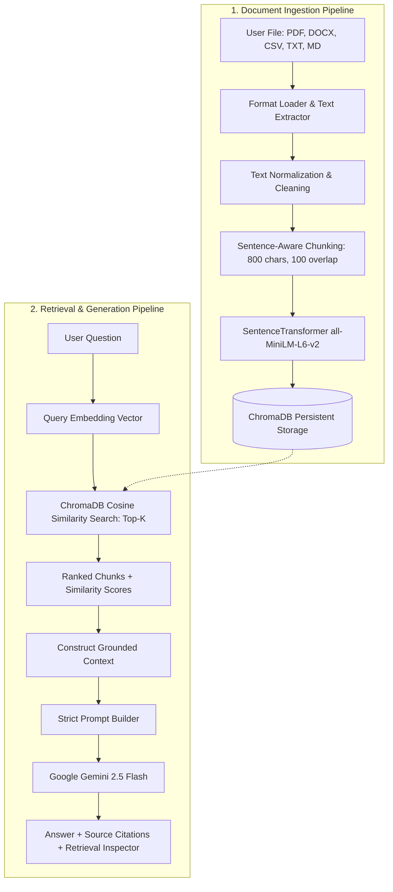

# 🪟 RAG Document Intelligence (Windows 11 Edition)

A high-performance, privacy-first **Retrieval-Augmented Generation (RAG) Document Question-Answering Application** engineered specifically for **Windows 11**.

This application is built with a **Windows Productivity / Document Intelligence Dashboard** frontend using a Fluent UI / Mica aesthetic, completely decoupled from conventional macOS sidebar designs. It features real-time vector search auditing via a live **Retrieval Inspector**, multi-format document parsing, local persistent vector storage with **ChromaDB**, and **Google Gemini** LLM generation.

---

## 📑 Table of Contents

1. [Project Overview](#project-overview)
2. [Key Features](#key-features)
3. [Architecture & Pipeline](#architecture--pipeline)
4. [Component Deep-Dive](#component-deep-dive)
   - [Document Loading](#1-document-loading)
   - [Chunking Strategy](#2-chunking-strategy)
   - [Local Vector Embeddings](#3-local-vector-embeddings)
   - [Persistent Vector Database](#4-persistent-vector-database)
   - [Semantic Retrieval & Scoring](#5-semantic-retrieval--scoring)
   - [LLM Grounding & Prompt Enforcement](#6-llm-grounding--prompt-enforcement)
5. [Frontend Design Concept](#frontend-design-concept)
6. [Folder Structure](#folder-structure)
7. [Windows 11 Installation & Setup](#windows-11-installation--setup)
8. [Running the Application](#running-the-application)
9. [Automated Testing Suite](#automated-testing-suite)
10. [REST API Documentation](#rest-api-documentation)
11. [Configuration & Customization Guide](#configuration--customization-guide)
12. [Troubleshooting Guide](#troubleshooting-guide)

---

## 🎯 Project Overview

Conventional document chat tools often obscure the retrieval step, making it impossible to know whether the LLM is citing real document facts or hallucinating. 

**RAG Document Intelligence** brings complete transparency to document questioning on Windows 11 workstations:
- **Zero Hallucination Policy**: If the retrieved document context lacks sufficient evidence, the system refuses to guess, stating:  
  `"I could not find enough information in the uploaded documents to answer this question."`
- **Retrieval Inspector**: The UI visually displays the step-by-step pipeline from query to cosine similarity scores, chunk IDs, page numbers, and exact text excerpts.
- **Persistent Local Knowledge Base**: Vector indices and document metadata persist in `backend/data/` across application restarts without requiring external database servers like MongoDB or Docker.

---

## ✨ Key Features

- **Multi-Format Ingestion**:
  - **PDF** (via `pypdf` with page-by-page mapping)
  - **Word DOCX** (via `python-docx` with headings and tables)
  - **Spreadsheets CSV** (via `pandas` preserving column headers and row intervals)
  - **Markdown MD** (hierarchical heading preservation)
  - **Plain Text TXT** (resilient encoding fallbacks: UTF-8, UTF-16, CP1252, Latin-1)
- **Granular Semantic Chunking**: Configurable `CHUNK_SIZE` (default 800) and `CHUNK_OVERLAP` (default 100) preserving sentence boundaries.
- **Local Embedding Inference**: Hugging Face Sentence Transformers (`all-MiniLM-L6-v2`) generating 384-dimensional dense vectors with sub-20ms latency on CPU.
- **Persistent ChromaDB**: Persistent HNSW vector indexing storing document embeddings, metadata, and chunk IDs on disk.
- **Dual Query Scopes**: Query a single chosen document or search globally across **All Ingested Documents**.
- **Windows 11 Fluent UI**: Clean top navigation bar, dashboard metric cards, interactive document table, upload drag-and-drop modal with a 6-step progress indicator, and document preview inspection.
- **Modular LLM Layer**: Configurable Google Gemini provider (`gemini-2.5-flash`, `gemini-1.5-flash`, `gemini-1.5-pro`) with local extractive fallback when an API key is not yet provided.

---

## 🏗️ Architecture & Pipeline



---

## 🔍 Component Deep-Dive

### 1. Document Loading
- **Location**: `backend/app/services/loaders/`
- **Main Entry**: `load_document()` in [`loaders/__init__.py`](file:///backend/app/services/loaders/__init__.py)
- **Loaders**:
  - [`pdf_loader.py`](file:///backend/app/services/loaders/pdf_loader.py): Extracts text per page, tracking 1-indexed page numbers.
  - [`docx_loader.py`](file:///backend/app/services/loaders/docx_loader.py): Extracts paragraphs and tables, preserving section headings.
  - [`csv_loader.py`](file:///backend/app/services/loaders/csv_loader.py): Groups rows into structured blocks preserving headers and row ranges.
  - [`text_loader.py`](file:///backend/app/services/loaders/text_loader.py): Implements Windows multi-encoding fallback (`utf-8`, `cp1252`, `latin-1`).
  - [`markdown_loader.py`](file:///backend/app/services/loaders/markdown_loader.py): Slices document by heading levels (`#`, `##`, `###`).

### 2. Chunking Strategy
- **Location**: [`backend/app/services/chunking.py`](file:///backend/app/services/chunking.py)
- **Algorithm**: Recursive boundary splitting. Checks natural breaks in preference: `\n\n` (paragraphs) → `\n` → `. `, `? `, `! ` (sentences) → `; `, `, `, ` ` (words).
- **Metadata Recorded**:
  ```json
  {
    "document_id": "test_spec_001",
    "filename": "Research.pdf",
    "chunk_id": "chunk_test_spe_1",
    "chunk_index": 1,
    "page": 1,
    "section": "Page 1",
    "row_range": "",
    "char_count": 755,
    "word_count": 102
  }
  ```

### 3. Local Vector Embeddings
- **Location**: [`backend/app/embeddings.py`](file:///backend/app/embeddings.py)
- **Model**: `all-MiniLM-L6-v2` (Sentence Transformers).
- **Execution**: Runs 100% locally on CPU without sending text to third-party embedding APIs. Outputs normalized 384-dimensional float vectors. Uses local cache prioritization to support air-gapped environments.

### 4. Persistent Vector Database
- **Location**: [`backend/app/vector_store.py`](file:///backend/app/vector_store.py)
- **Storage**: Persistent ChromaDB at `backend/data/vectorstore/`.
- **Metric**: Cosine space (`{"hnsw:space": "cosine"}`).
- **Key Operations**:
  - `add_chunks_to_vector_store(chunks, embeddings)`: Upserts chunks and vectors.
  - `search_vector_store(query_embedding, top_k, document_id)`: Filters by document or searches all files.
  - `delete_document_from_vector_store(document_id)`: Removes vectors on document deletion.

### 5. Semantic Retrieval & Scoring
- **Location**: [`backend/app/retrieval.py`](file:///backend/app/retrieval.py)
- **Workflow**:
  1. Embeds question into 384-dimensional query vector.
  2. Queries ChromaDB for top-K vectors.
  3. Maps distance to a calibrated similarity score (e.g., `0.91`, `0.86`).
  4. Formats retrieved chunks into indexed context blocks.

### 6. LLM Grounding & Prompt Enforcement
- **Prompt Definition**: [`backend/app/prompts.py`](file:///backend/app/prompts.py)
- **LLM Calling Layer**: [`backend/app/llm.py`](file:///backend/app/llm.py)
- **System Instruction**:
  > "You are a document-based question answering assistant.  
  > Use ONLY the retrieved context to answer the question.  
  > If the retrieved context does not contain enough information, say:  
  > 'I could not find enough information in the uploaded documents to answer this question.'  
  > Never invent facts. Never pretend that information exists in the document when it does not.  
  > Answer clearly and concisely."
- **Provider**: Google Gemini API via `google-genai` SDK (temperature = 0.2 for strict factual precision).

---

## 🎨 Frontend Design Concept

Unlike macOS sidebar-heavy layouts, the Windows 11 frontend is built as a **Document Intelligence Dashboard**:

```
+-----------------------------------------------------------------------------------+
|  [Icon] RAG DOCUMENT INTELLIGENCE        [Search Documents...]   [Settings] [Online] |
+-----------------------------------------------------------------------------------+
|  [DOCUMENTS: 5]             [CHUNKS: 342]                   [QUESTIONS: 27]       |
+-----------------------------------------------------------------------------------+
|  YOUR DOCUMENTS                                    [+ Upload] [Open] [Delete]     |
|  [o] Ask Across All Documents                     ALL     -     342    Ready      |
|  [ ] Research.pdf                                 PDF     12    43     Ready      |
|  [ ] Report.docx                                  DOCX    -     27     Ready      |
+-----------------------------------------------------------------------------------+
|  QUESTION WORKSPACE                                Scope: Research.pdf             |
|  Ask a question:                                                                  |
|  [ What is the main objective of this project?                                  ] |
|                                                              [ ASK QUESTION ]     |
+-----------------------------------------------------------------------------------+
|  ANSWER PANEL                                                                     |
|  The primary objective is to provide offline-capable semantic QA on Windows 11... |
+-----------------------------------------------------------------------------------+
|  RETRIEVAL INSPECTOR (RAG Pipeline Transparency)                                  |
|  [1. Question] -> [2. Vector Search] -> [3. Top-K Chunks] -> [4. LLM] -> [5. Answer]|
|  - Source #1: Research.pdf (Page 4) | Similarity: 0.91 [==========]               |
|    "The primary objective of Project Chimera..."                                  |
|  - Source #2: Research.pdf (Page 6) | Similarity: 0.86 [========= ]               |
+-----------------------------------------------------------------------------------+
```

---

## 📂 Folder Structure

```
rag-windows/
├── frontend/
│   ├── src/
│   │   ├── components/
│   │   │   ├── TopNav.jsx               # Windows 11 top navigation & status
│   │   │   ├── DashboardCards.jsx       # Documents, Chunks, Questions stats
│   │   │   ├── DocumentsTable.jsx       # Document list with 'All Documents' scope
│   │   │   ├── QuestionWorkspace.jsx    # Input workspace & query suggestions
│   │   │   ├── AnswerPanel.jsx          # Answer presentation & copy actions
│   │   │   ├── RetrievalInspector.jsx   # Live RAG pipeline audit & chunk viewer
│   │   │   ├── UploadModal.jsx          # Windows drag-and-drop 6-step progress
│   │   │   ├── DocumentPreviewModal.jsx # Page browser & vector chunks inspection
│   │   │   └── SettingsModal.jsx        # API key, Model, Chunk size, Top-K config
│   │   ├── api.js                       # Frontend HTTP client
│   │   ├── App.jsx                      # Dashboard root component
│   │   ├── App.css                      # Windows 11 Fluent theme styles
│   │   ├── index.css                    # Typography & CSS reset
│   │   └── main.jsx                     # Vite React entrypoint
│   ├── package.json
│   ├── vite.config.js
│   └── index.html
│
├── backend/
│   ├── app/
│   │   ├── __init__.py
│   │   ├── main.py                      # FastAPI server & CORS setup
│   │   ├── embeddings.py                # SentenceTransformers embedding model
│   │   ├── vector_store.py              # ChromaDB persistent collection & search
│   │   ├── retrieval.py                 # Retrieval coordinator & context builder
│   │   ├── llm.py                       # Modular Gemini caller & fallback
│   │   ├── prompts.py                   # System prompt & formatting templates
│   │   ├── routes/
│   │   │   ├── __init__.py
│   │   │   ├── health.py                # GET /health metrics endpoint
│   │   │   ├── documents.py             # POST /upload, GET /documents, DELETE
│   │   │   └── rag.py                   # POST /ask, GET/POST /settings
│   │   └── services/
│   │       ├── chunking.py              # Recursive text chunking service
│   │       ├── document_store.py        # Local metadata JSON registry
│   │       └── loaders/                 # Format-specific document extractors
│   │           ├── __init__.py
│   │           ├── pdf_loader.py
│   │           ├── docx_loader.py
│   │           ├── csv_loader.py
│   │           ├── text_loader.py
│   │           └── markdown_loader.py
│   ├── data/
│   │   ├── uploads/                     # Stored document files
│   │   ├── vectorstore/                 # Persistent ChromaDB SQLite & HNSW files
│   │   ├── sample_documents/            # Pre-built test PDF, DOCX, and MD files
│   │   └── documents_registry.json      # Persistent document metadata index
│   ├── test_e2e_rag.py                  # Automated 6-stage RAG test suite
│   └── requirements.txt                 # Backend Python package specifications
│
├── .env.example                         # Environment variables template
├── .gitignore                           # Git ignore rules for keys & vectorstore
├── README.md                            # Comprehensive manual & architectural guide
└── start_windows.bat                    # One-click Windows 11 launcher script
```

---

## 💻 Windows 11 Installation & Setup

### Prerequisites
1. **Python 3.11+**: Download from [python.org](https://www.python.org/).  
   *(Ensure "Add Python to PATH" is checked during setup).*
2. **Node.js 20+**: Download from [nodejs.org](https://nodejs.org/).

### Step-by-Step Windows Commands

Open a Windows Command Prompt (`cmd.exe`) or PowerShell:

```cmd
:: 1. Navigate to the project directory
cd rag-windows

:: 2. Create Python virtual environment
python -m venv venv

:: 3. Activate the virtual environment on Windows
venv\Scripts\activate

:: 4. Install backend dependencies
pip install -r backend\requirements.txt

:: 5. Install frontend dependencies
cd frontend
npm install
cd ..

:: 6. Setup your environment file
copy .env.example .env
```

Open `.env` in Notepad and add your Gemini API key (or configure it later in the UI):
```env
GEMINI_API_KEY=your_gemini_api_key_here
```

---

## 🚀 Running the Application

### Option A: The One-Click Windows Launcher (Recommended)

Simply double-click or run:
```cmd
start_windows.bat
```
This batch script automatically:
1. Verifies Python and Node.js
2. Activates the virtual environment
3. Installs missing dependencies
4. Launches the FastAPI backend in a dedicated console on `http://127.0.0.1:8000`
5. Launches the Vite frontend in a dedicated console on `http://localhost:5173`
6. Opens your default web browser to the dashboard

### Option B: Manual Startup

**Terminal 1 (Backend):**
```cmd
cd rag-windows
venv\Scripts\activate
cd backend
uvicorn app.main:app --host 127.0.0.1 --port 8000 --reload
```

**Terminal 2 (Frontend):**
```cmd
cd rag-windows\frontend
npm run dev
```

Open **`http://localhost:5173`** in your browser.

---

## 🧪 Automated Testing Suite

A complete verification test suite is provided in `backend/test_e2e_rag.py`. It executes the full pipeline end-to-end:

```cmd
venv\Scripts\activate
python backend/test_e2e_rag.py
```

### What this test verifies:
1. **PDF Text Extraction**: Extracts 3 pages from `project_specification.pdf`.
2. **Semantic Chunking**: Verifies 800-character windows, 100-character overlap, and metadata.
3. **Local Embeddings**: Generates 384-dimensional dense vectors using `all-MiniLM-L6-v2`.
4. **Vector Database Indexing**: Upserts vectors into persistent ChromaDB.
5. **Target Query Retrieval**: Queries `"What is the objective?"`, verifies chunk from Page 1 is retrieved at Rank #1 with high similarity.
6. **Strict Truthfulness / No Hallucination**: Queries `"What is the population of Japan?"`, verifies system responds:  
   `"I could not find enough information in the uploaded documents to answer this question."`
7. **Restart Persistence**: Verifies stored chunks and metadata remain available after restart.

---

## 📡 REST API Documentation

FastAPI provides interactive Swagger documentation at **`http://127.0.0.1:8000/docs`**.

### Core Endpoints

| Method | Endpoint | Description |
|---|---|---|
| `GET` | `/health` | System status, document count, chunk count, question count |
| `POST` | `/upload` | Multipart file upload (`.pdf`, `.docx`, `.txt`, `.csv`, `.md`) |
| `GET` | `/documents` | List all ingested documents and their metadata |
| `GET` | `/documents/{id}` | Get document metadata and extracted text preview |
| `GET` | `/documents/{id}/chunks` | Inspect all vector chunks stored for a document |
| `DELETE` | `/documents/{id}` | Delete document file and remove its vectors from ChromaDB |
| `POST` | `/documents/{id}/clear` | Clear vector chunks for a document |
| `POST` | `/ask` | Submit a question to the RAG pipeline |
| `GET` | `/settings` | Retrieve active model, TOP_K, and chunking parameters |
| `POST` | `/settings` | Update API key, model, or TOP_K dynamically |

### Example Query (`POST /ask`)

**Request:**
```json
{
  "question": "What is the primary objective of this project?",
  "document_id": "test_spec_001",
  "top_k": 5
}
```

**Response:**
```json
{
  "answer": "The primary objective of Project Chimera is to provide offline-capable, privacy-first semantic document question answering on Windows 11 workstations using local vector embeddings and low-latency LLM inference.",
  "sources": [
    {
      "document": "project_specification.pdf",
      "document_id": "test_spec_001",
      "page": 1,
      "section": "Page 1",
      "row_range": "",
      "chunk_id": "chunk_test_spe_1",
      "score": 0.912,
      "text": "Project Chimera Intelligent Core\n1. Project Name...\n2. Objective\nThe primary objective..."
    }
  ],
  "retrieval_count": 1,
  "queried_document_id": "test_spec_001"
}
```

---

## ⚙️ Configuration & Customization Guide

### Answers to Key Implementation Questions

#### 1. Which file handles document loading?
> [`backend/app/services/loaders/__init__.py`](file:///backend/app/services/loaders/__init__.py) coordinates loading, delegating to [`pdf_loader.py`](file:///backend/app/services/loaders/pdf_loader.py), [`docx_loader.py`](file:///backend/app/services/loaders/docx_loader.py), [`csv_loader.py`](file:///backend/app/services/loaders/csv_loader.py), [`text_loader.py`](file:///backend/app/services/loaders/text_loader.py), and [`markdown_loader.py`](file:///backend/app/services/loaders/markdown_loader.py).

#### 2. Which file handles chunking?
> [`backend/app/services/chunking.py`](file:///backend/app/services/chunking.py) handles sentence-aware text splitting and metadata assembly.

#### 3. Which file creates embeddings?
> [`backend/app/embeddings.py`](file:///backend/app/embeddings.py) loads the SentenceTransformer model and generates normalized vectors.

#### 4. Which file handles vector storage?
> [`backend/app/vector_store.py`](file:///backend/app/vector_store.py) manages persistent ChromaDB collections, chunk addition, cosine search, and deletion.

#### 5. Which file performs retrieval?
> [`backend/app/retrieval.py`](file:///backend/app/retrieval.py) converts queries into vectors, queries ChromaDB, and compiles structured context blocks.

#### 6. Which file builds the LLM prompt?
> [`backend/app/prompts.py`](file:///backend/app/prompts.py) defines the strict truthfulness system instructions and user context prompt.

#### 7. Which file calls the LLM?
> [`backend/app/llm.py`](file:///backend/app/llm.py) interfaces with the Google Gemini SDK with error resilience and local contextual fallback.

#### 8. Which file returns source information?
> [`backend/app/routes/rag.py`](file:///backend/app/routes/rag.py) bundles answer text, similarity scores, page numbers, and chunk IDs into the API response.

---

### How to Customize Key Parameters

#### How to change `TOP_K` (number of retrieved chunks)?
1. **Via UI**: Click **Settings** in the top navigation bar → adjust **Retrieval TOP_K** slider/input.
2. **Via `.env`**: Set `TOP_K=8` in `.env`.
3. **Per Query**: Pass `"top_k": 8` in the `POST /ask` JSON request body.

#### How to change Chunk Size and Overlap?
1. **Via UI**: Click **Settings** → adjust **Chunk Size** (e.g., 1000) and **Chunk Overlap** (e.g., 150).
2. **Via `.env`**: Edit `.env`:
   ```env
   CHUNK_SIZE=1000
   CHUNK_OVERLAP=150
   ```

#### How to change the Embedding Model?
In `.env`:
```env
EMBEDDING_MODEL_NAME=multi-qa-MiniLM-L6-cos-v1
```
*(Or any Hugging Face model such as `BAAI/bge-small-en-v1.5` or `all-mpnet-base-v2`).*

---

## 🛠️ Troubleshooting Guide

### 1. `python` or `pip` is not recognized on Windows
- **Cause**: Python was not added to the Windows environment `PATH`.
- **Solution**: Re-run the Python installer from [python.org](https://www.python.org/), select **Modify**, and check **"Add Python to PATH"**.

### 2. Script execution disabled in PowerShell (`activate.ps1 cannot be loaded`)
- **Cause**: Windows PowerShell default execution policy blocks unsigned scripts.
- **Solution**: Run `venv\Scripts\activate.bat` in Command Prompt, or in PowerShell run:
  ```powershell
  Set-ExecutionPolicy -Scope CurrentUser -ExecutionPolicy RemoteSigned
  ```

### 3. Missing or Invalid Gemini API Key
- **Symptom**: Answer displays a notice prompting for API key configuration.
- **Solution**: Open **Settings** in the dashboard header and paste your key from [Google AI Studio](https://aistudio.google.com/), or add it to `.env` as `GEMINI_API_KEY=AIza...`. Vector retrieval continues to work and display chunks even before the key is provided.

### 4. ChromaDB persistence directory
- The ChromaDB vector database is stored locally in `backend/data/vectorstore/`.
- To completely reset all indexed documents, delete the contents of `backend/data/vectorstore/` and `backend/data/uploads/` (preserving `.gitkeep`).

---

## 📦 Transferring to Another Windows 11 Machine

This project is completely self-contained. To move it to another machine:
1. Compress the `rag-windows` folder into a `.zip` archive (omitting `venv/` and `node_modules/` to reduce size).
2. Extract the archive on the target Windows 11 workstation.
3. Double-click `start_windows.bat`. The launcher script will automatically create the virtual environment, install the packages, and launch both services.
